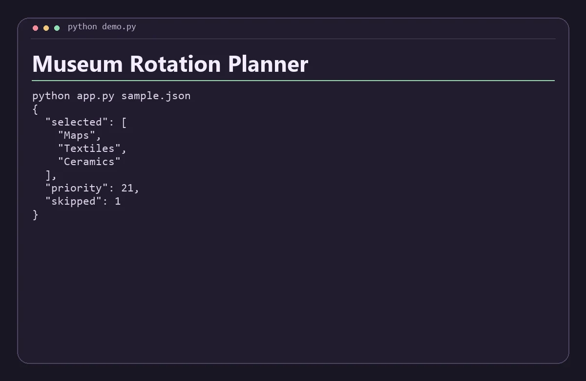

# Museum Rotation Planner

Schedule the highest-priority display requests across a single exhibition case using interval optimization.



## Run

Install Python 3.11 or newer. Run these commands from the repository root.

```sh
python app.py sample.json
```

Replace `sample.json` with a JSON file following the same structure. The app prints a JSON report to standard output.

Provide unique IDs, inclusive ISO start dates, exclusive ISO end dates, and nonnegative integer priorities. Two displays can share an end/start date.

## Verify

Run `python check.py` with Python 3.11 or newer after the build step when applicable. The check verifies the bundled scenario and confirms that an invalid input returns an error.
